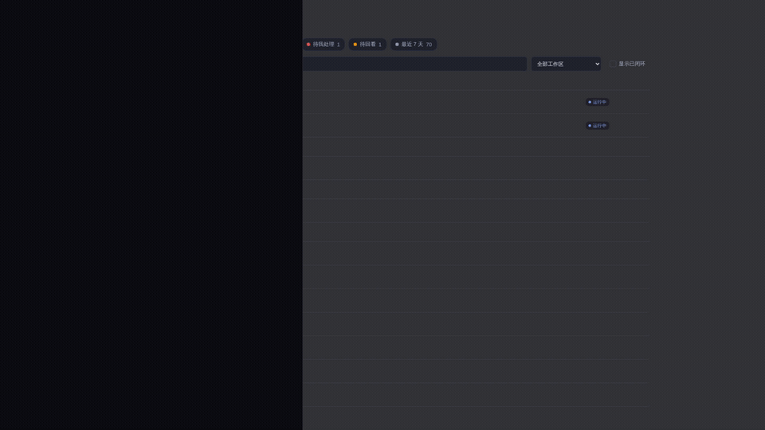
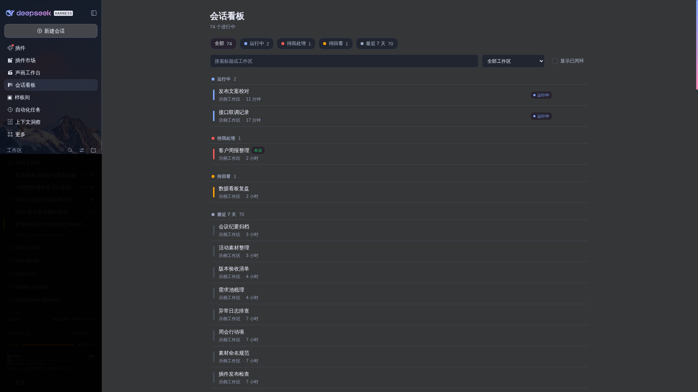
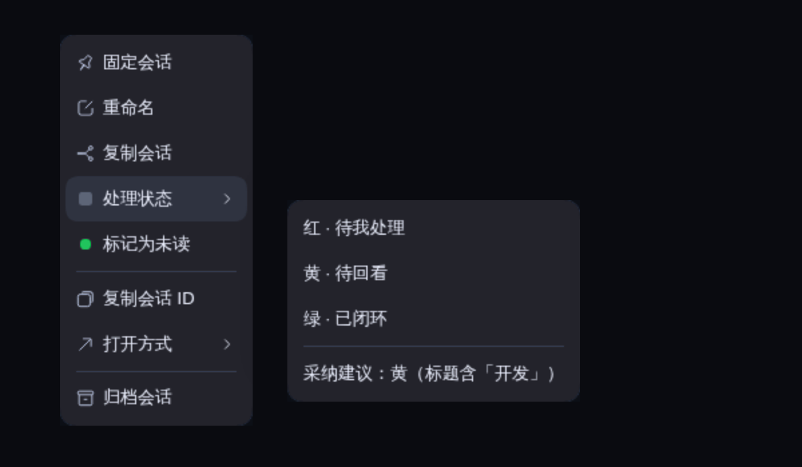

[简体中文](README.md) | **English**

# Session Board · dsh-session-triage

> A session board for DSH Web: unread marks, red / amber / green processing status, and one cross-workspace overview.




DSH's built-in green dot comes from `UiSession.completionUnread`: it appears when a session finishes in the background, disappears as soon as you open the session, and there is no way to restore it. With sessions spread across workspaces, finding the ones that still need attention means scrolling the sidebar.

This plugin adds three things:

- **Unread**: right-click a session and choose **Mark as unread** to bring the native green dot back; opening the session clears it again.
- **Processing status**: right-click and choose red / amber / green; a persistent bar appears on the left edge of the session row. It survives reloads and stays visible while the session is running or waiting for approval.
- **Session board**: a cross-workspace overview that groups sessions into **Needs me**, **Review**, **Running**, and **Untriaged · 7d**.

It is a client-only plugin: it does not read message content, call a model, or modify host data. Unread marks, statuses, and settings live only in the current browser.

## Screenshots



The **Processing status** submenu:



> Screenshots use the Chinese UI with demo data; labels follow DSH's interface language. The animated demo above is also Chinese.

## Quick start

Requires **DSH Web 0.2.x** (tested on 0.2.2-rc.5) and **Node.js 20+**. The plugin is installed from GitHub; it is not published to npm.

```bash
dsh plugin --profile web add github:huihui308/dsh-session-triage
```

Refresh the page, then:

1. Open **Session board** from the sidebar.
2. Right-click any session to mark it unread or set its processing status.
3. Use the board to review sessions across all workspaces.

## What the statuses mean

The plugin uses a processing status rather than an abstract "importance" score:

| Status | Meaning | Typical use |
|---|---|---|
| Red · Needs me | I need to take the next action | Open question, decision, risk, deadline, customer / contract / interview |
| Amber · Review | There is a result or conclusion, but it is not settled | Plan, analysis, fix, finished development, unread result |
| Green · Settled | No further action needed | Delivered, resolved, reference material |

**Unread is a separate channel.** The green dot means "there is a result I have not looked at"; the colored bar means "where this task stands". They can coexist and do not overwrite each other.

## Usage

### Unread

1. Right-click a session (or its `…` menu) → **Mark as unread**. The green dot returns.
2. Right-click again → **Clear unread**; opening the session also clears it.

### Processing status

1. Right-click → **Processing status** → red / amber / green.
2. Right-click again → **Clear processing status**.
3. The menu may offer **Apply suggestion: red (…)**. This is a client-side suggestion based on the title and live status; it is written only when you click it, never automatically.

Suggestions only read the session title and live status (waiting for you, unread result). They do not read message content or call a model. Override them manually when they are wrong.

### Session board

The board collects sessions across workspaces on one page:

- **Unread rows** show a green **Unread** pill after the title. A running session still shows **Running** on the right; both can appear together.
- **Groups**: Running / Needs me (red, waiting for you) / Review (amber or unread) / Untriaged · 7d / Settled (hidden by default; toggle with **Show settled**).
- **Rules**: archived, blank New Session, and subagent sessions are excluded. Settled sessions are hidden by default. A session belongs to exactly one group: red / waiting first, then amber; a running session without an explicit red/amber status goes to Running; unread does not move a running session; settled comes last.
- **Filters**: search title or workspace, filter by group chip or workspace. Counts follow the current filter.
- **Quick dots**: hover a row to reveal red / amber / green dots. Click to set, click the same color again to clear. Click the row itself to open the session; browsing the board does not interrupt the current session.
- **Entry**: the sidebar entry can be pinned, or tucked under **More** like other panels. From the keyboard, `Ctrl+Alt+P` (macOS `Cmd+Alt+P`) opens the board; press it again to return to the panel or session you came from. You can also change it from **Change** in the board header.

### Scheduled tasks on the board

- **The Scheduled chip** in the filter row swaps the list for host tasks: next run, target session, active / paused / ended.
- **Row actions**: pause / resume, run now, edit ↗ (opens the official Automation tasks panel), delete (a second click confirms; reverts after four seconds).
- **⏱ on a session row**: shown when a task targets that session, with the nearest next run; hover lists every task attached to it.
- **Ended** tasks follow the **Show settled** toggle. Prompts are not expanded here — edit them in the official panel.
- Data goes through `ctx.remote.schedule` (`catalog` / `edit` / `run`) and follows `schedule/changed`; writes carry `expectedUpdatedAt` and only report conflicts.

### Persistence and interrupted runs

- **State lives on the host**: unread marks, red / amber / green status, and the last-seen running set are written to `$DSH_HOME/session-triage/state.json` through `/session-triage/state` (host half). localStorage is only a cache. A dsh web restart, an http ↔ https switch, or a different IP / hostname no longer wipes them.
- **Upgrade path**: older versions only wrote localStorage; the first load after upgrading pushes those marks to the host instead of dropping them.
- **Out of reach**: marks stranded on another origin (for example http before switching to https) cannot be read — same-origin policy — and are not recoverable.
- **Interrupted runs**: a Session that starts running is recorded; after a restart, one that is no longer running appears under **Ended mid-run** with an *Interrupted* badge. Opening it, letting it run again, or setting red / amber / green clears the mark.
- Only "saw the start, never saw the end" counts: a run that finished while the page was alive is not flagged. Nothing is written before the Session list is available, so a still-connecting page cannot clobber the snapshot.

### Settings and shortcuts

Settings → General → **Session marks**:

- **Suggest processing status**: turn off to remove **Apply suggestion** from menus and hover cards. Manual red / amber / green still work.
- **Show processing status bar**: turn off to hide the left-edge bar. The status is kept and remains editable from the context menu; the hover card still shows it.

Edit shortcuts under **Settings → General → Keyboard shortcuts → Edit shortcuts**. Plugin commands appear in the list automatically:

| Command | Default | Action |
|---|---|---|
| Next unread session | `Ctrl+Shift+,` (macOS `Cmd+Shift+,`) | Open the next session with an unread mark; no-op when only the current session is marked |
| Cycle current session status | `Ctrl+Shift+.` (macOS `Cmd+Shift+.`) | None → red → amber → green → none |
| Open / leave the session board | `Ctrl+Alt+P` (macOS `Cmd+Alt+P`) | Open the board and focus its search field; press again to return to the panel / session you came from; editable from the board header |

- Windows / macOS browsers accept `Mod+Alt+letter`, which is what the board uses. Some Linux browsers restrict `Mod+Alt`; the board header shows the effective binding and lets you record a supported one.
- The first two commands use `Mod+Shift+punctuation`; `Mod+/` is already used by **Open keyboard shortcuts**.
- OS-level hotkeys (screenshot tools, input methods, screen recorders) win over the browser, so a colliding key never reaches DSH. Rebind it in **Edit shortcuts** by clicking the command and pressing a new combination.
- The **Scheduled** view depends on the Automation tasks client service (`remote.schedule`); disabling that bundle prevents this plugin from loading.
- Shortcuts also work while an input or editor is focused (`regions: ['page', 'editable']`); they are modified punctuation combinations and do not block normal typing.
- If a default conflicts on a platform, the command is left unbound (it still appears in the shortcut list; record a new combination).

## Install and upgrade

### Requirements

- DSH Web 0.2.x (tested on 0.2.2-rc.5; `engines.dsh` restricts to 0.2.x).
- Node.js 20+ (for the CLI / pnpm install).
- DSH Web only; desktop and other clients are untested.

### Install from GitHub

```bash
dsh plugin --profile web add github:huihui308/dsh-session-triage
```

`web` is the default profile; replace it with your own. The package is plain JavaScript with no build or `prepare` step. `dsh plugin add` appends `dsh-session-triage` to the profile's `dsh.profile.bundles`.

For production, pin a release tag so a later push to master cannot change what is installed:

```bash
dsh plugin --profile web add "github:huihui308/dsh-session-triage#v0.8.0"
```

You can also replace `v0.8.0` with a full or short commit SHA. Refresh the page after installation. If the sidebar entry does not appear, confirm that `dsh-session-triage` is listed in the profile's `dsh.profile.bundles`.

### Upgrade

```bash
dsh plugin --profile web remove dsh-session-triage
dsh plugin --profile web add github:huihui308/dsh-session-triage
```

Marks live in browser localStorage, so reinstalling the plugin does not lose them.

### Uninstall

```bash
dsh plugin --profile web remove dsh-session-triage
```

To clear local marks too, remove the localStorage keys listed under **Data and privacy**.

### Local development

```bash
git clone https://github.com/huihui308/dsh-session-triage.git
cd dsh-session-triage
dsh plugin --profile web add "link:$PWD"
```

There is no build step: edit `client.js` and refresh. During development the client bundle is reloaded through DSH's HMR. On Windows, replace `$PWD` with an absolute path.

### Troubleshooting

- **No sidebar entry**: confirm the package is installed and `dsh-session-triage` is in the profile's bundles, then refresh.
- **No context menu**: right-click a session row. Blank New Session, archived rows, and subagent sessions do not expose the full menu.
- **Shortcut does nothing**: check that the command has a binding under Keyboard shortcuts. A conflicting default may be left unbound; record a new combination.
- **Reset local marks**: delete the keys listed under **Data and privacy** in DevTools, then refresh.

## Data and privacy

All data stays in the current browser and origin:

| Key | Contents |
|---|---|
| `dsh.session-unread.v1` | Unread cache: `{ "<sessionId>": <marked-at epoch ms> }` |
| `dsh.session-triage.v1` | Processing status: `{ "<sessionId>": { level, reason, source, updatedAt } }` |
| `dsh.session-unread.settings.v1` | Settings: `{ autoSuggest, showBars }` |
| `$DSH_HOME/session-triage/state.json` | Authoritative copy: `{ unread, triage, running, interrupted }`, mode 600 |

- Unread and status maps are capped at 500 entries and expire after 180 days; malformed JSON falls back to defaults.
- The plugin makes no network requests, reads no message content, and calls no model. It only reads the client-side sessions / workspaces / uiSession snapshots.
- Data does not sync across browsers, devices, or origins. Uninstalling the plugin does not delete it automatically.

## Compatibility and limits

- DSH Web 0.2.x only; regression-test before upgrading a major DSH version.
- It does not change native session ordering. The board supports group-chip, workspace, and keyword filters, but not a separate per-color or per-unread filter.
- Archived rows do not show the status bar and do not expose the full menu.
- Suggestions are a title + live-status heuristic and can be wrong; they are never applied automatically.
- The board does not show the last message, supports no drag-and-drop, and has no column or time-window view; these are future work.
- The green dot, colored bar, and board are client-side enhancements. Removing the plugin leaves host session data untouched.

## Development

Plugin layout:

```text
client.js         browser half: menus, status bars, settings, shortcuts, session board
index.js          host half: no-op apply, present so the package is a complete bundle
cordis.patch.yml  mounts the plugin into a DSH profile
docs/             README screenshots
```

- No build and no runtime dependencies; `client.js` contains all behavior.
- Testing is manual: install the local link in DSH Web and exercise menus, bars, settings, shortcuts, board grouping / filters / open / narrow layout.
- Issues and pull requests are welcome on GitHub. Development happens on `develop`; stable changes are merged into `master`.
- Before a release, sync the `package.json` version and the version badges in both READMEs; refresh `docs/` screenshots when the UI changes.

## Migration

- The old package name was `dsh-session-unread`. It was renamed to `dsh-session-triage` on 2026-11-24; the Chinese UI label is **会话看板**.
- The package and repository keep the name `dsh-session-triage`. The localStorage keys remain `dsh.session-unread.*` / `dsh.session-triage.*`, so existing marks and settings survive.
- New installs need no migration. Existing users can reinstall with the upgrade command.

## License

[MIT](LICENSE)