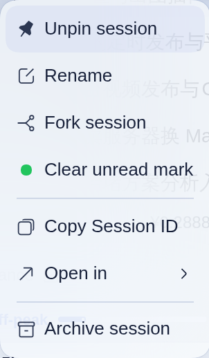

# dsh-session-unread

给 DSH Web 的会话列表加一个「用户自己的未读标记」。

## 解决什么问题

DSH 侧栏的绿点（`StateDot state="done"`）来自 `UiSession.completionUnread`：
某个会话在你没看它的时候跑完了，它就亮；你点开会话，绿点立刻消失，而且没有
任何办法把它找回来。会话一多、跨几个工作区，想回头找那次结果就只能靠翻列表。

这个插件在右键菜单里加一项「标记为未读」，把绿点重新点亮：

- 绿点和原生的「已完成」点是同一个 `StateDot`，同一位置（行首 16px 状态格）。
- 刷新页面、重连、宿主重启都还在（浏览器 `localStorage`）。
- 点开该会话时自动清除，行为跟微信的未读一致。
- 会话正在运行 / 等待审批 / 有待回答时，原生状态点优先，二者不会并排出现。
- 悬停卡片里多一行「未读 · 点开后自动清除」，解释这个点的归属。

## 效果

标记后行首重新出现绿点：


右键菜单里多一项（已标记时变为「取消未读标记」）：



悬停卡片里说明这个点由谁维护：


## 使用

1. 在侧栏会话上点右键（或该行的 `…` 菜单）。
2. 选「标记为未读」，行首出现绿点。
3. 想取消时再右键选「取消未读标记」；点开该会话也会自动清除。

## 安装（本机 profile）

源码目录：`/mnt/sdb1/agent/dsh-session-unread`

### 方式 A：Plugin Manager（推荐）

在 DSH Web 侧栏的 **Plugins** 页面里用本地开发链接安装：

```text
link:/mnt/sdb1/agent/dsh-session-unread
```

安装并启用后刷新页面。HMR 开启时宿主不需要重启。

### 方式 B：dsh CLI（本机已用这条）

```bash
dsh plugin --profile web add link:/mnt/sdb1/agent/dsh-session-unread
```

`dsh plugin add` 会在 profile 里建好 `link:` 依赖，并把
`dsh-session-unread` 自动追加到 `dsh.profile.bundles`。宿主开启 HMR 时会
直接重新挂载，不用重启；没有 HMR 时重启 dsh web 生效。

### 方式 C：手工挂载（兜底）

在 profile 目录（本机 `~/.dsh/profiles/web`）里建软链：

```bash
ln -s /mnt/sdb1/agent/dsh-session-unread node_modules/dsh-session-unread
```

在 `package.json` 的 `dependencies` 里加 `link:` 依赖，再把
`dsh-session-unread` 追加到 `dsh.profile.bundles` 数组末尾，最后让宿主
重新加载配置（有 HMR 时改 bundles 列表即可，没有则重启）。

## 边界

- 标记是**浏览器本地**的：换浏览器、换设备、清空站点数据后不会带过去；
  会话本身完全不受影响。
- 标记**不会改变会话排序**。会话仍按最近更新排；如果它被折叠在「显示更多」
  后面，需要先展开列表（或直接搜索标题）。
- 已归档会话的行首本来就不显示状态点，因此归档行不提供这个菜单项。

## 存储

- key：`localStorage["dsh.session-unread.v1"]`
- 结构：`{ "<sessionId>": <marked-at epoch ms> }`
- 上限：最多 500 条，超过 180 天自动丢弃；损坏的 JSON 按空表处理。
- 作用域：当前浏览器 + 当前 origin（`http://192.168.171.198:3080`）。
  换浏览器或清空站点数据后标记丢失，会话本身不受影响。

## 设计取舍

- **不改核心**：不碰 `UiSession.completionUnread` 私有集合，也不 monkey-patch
  `publishStatus`。用官方的 `sidebar.session.row.leading` 槽位渲染同一个
  `StateDot`，核心升级时不会因为私有字段改名而炸。
- **只做加法**：原生状态点存在时槽位本就不渲染，所以不会和运行中 / 审批中
  的状态打架。
- **客户端本地**：未读是浏览器视角的偏好，不值得进会话日志或同步到服务端；
  代价是换浏览器要重新标。
