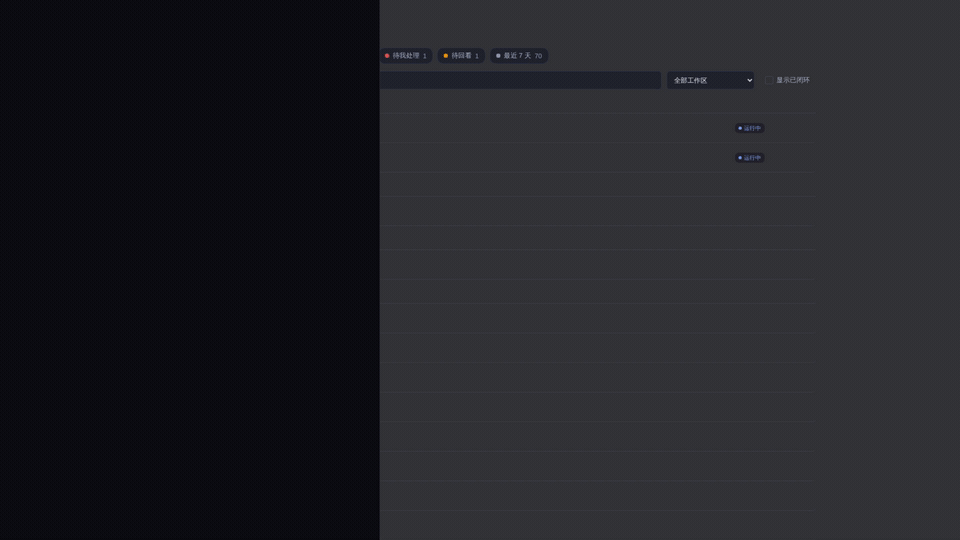
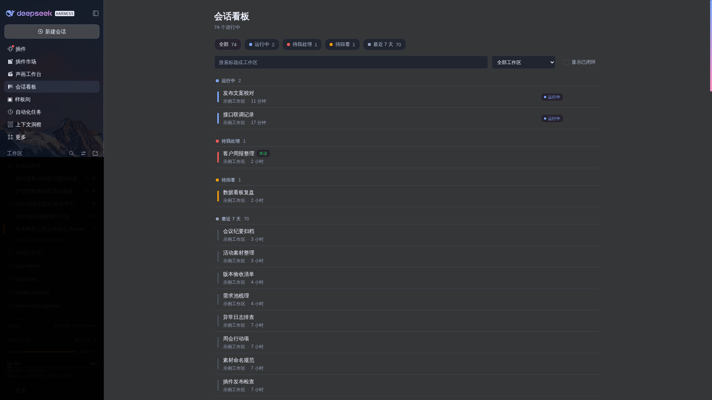

**简体中文** | [English](README.en.md)

# 会话看板 · dsh-session-triage

> DSH Web 的会话看板：给会话加未读和红 / 黄 / 绿处理状态，再用一个跨工作区总览页把待处理会话收拢。




DSH 侧栏的原生绿点来自 `UiSession.completionUnread`：会话在后台跑完时亮，点开就消失，没有恢复入口。会话一多、跨几个工作区，回头找结果只能翻列表。

这个插件补三件事：

- **未读**：右键「标记为未读」，把原生同款绿点重新点亮；点开会话自动清除。
- **处理状态**：右键选红 / 黄 / 绿，行左侧出现常驻色条；刷新后仍在，运行中 / 审批中也能看见。
- **会话看板**：侧栏打开一个跨工作区总览页，按「待我处理 / 待回看 / 运行中 / 最近未标记」收拢会话。

实现上是纯客户端插件：不读消息内容、不调用模型、不修改宿主数据；未读、状态和设置都只存在当前浏览器。

## 截图



右键菜单里的「处理状态」子菜单：


> 中文界面截图；英文界面截图见 [English](README.en.md)。截图使用示例工作区数据。

## 快速开始

需要 **DSH Web 0.2.x**（实测 0.2.2-rc.5）与 **Node.js 20+**。目前从 GitHub 安装，未发布到 npm。

```bash
dsh plugin --profile web add github:huihui308/dsh-session-triage
```

刷新页面后：

1. 侧栏出现 **Session board**（中文界面为 **会话看板**）。
2. 右键任意会话，可以「标记为未读」或设置「处理状态」。
3. 打开会话看板，跨工作区查看所有进行中的会话。

## 处理状态怎么定义

用「处理状态」而不是抽象的「重要性」：

| 状态 | 含义 | 典型场景 |
|---|---|---|
| 红 · 待我处理 | 需要我下一步动作 | 未决问题、待决策、风险、截止、客户 / 合同 / 面试 |
| 黄 · 待回看 | 有产出 / 结论，但未归档 | 方案、分析、修复、开发完成、有未读结果 |
| 绿 · 已闭环 | 可不再管 | 已交付、已解决、参考资料 |

**未读是独立的通道**：绿点表示「有结果还没看」，色条表示「这件事处理到哪一步」。两者可以同时存在，互不覆盖。

## 使用

### 未读

1. 右键会话（或该行的 `…` 菜单）→「标记为未读」，行首出现绿点。
2. 再右键 →「取消未读标记」；点开该会话也会自动清除。

### 处理状态

1. 右键 →「处理状态」→ 红 / 黄 / 绿。
2. 再右键 →「清除处理状态」。
3. 菜单里可能出现「采纳建议：红（…）」：这是客户端按标题和实时状态算出的建议，点一下才会写入，不会自动应用。

自动建议只看标题和实时状态（等待你响应、有未读结果），不读会话内容、不调用模型；判断错时手动覆盖即可。

### 会话看板

会话看板把跨工作区的会话收在一页：

- **未读行**在标题后显示绿色「未读」标签；运行中的话右侧仍保留 `Running`，两个标签可以同时出现。
- **分组**：运行中 / 待我处理（红、等你响应）/ 待回看（黄、未读）/ 最近 7 天未标记 / 已闭环（默认隐藏，可切换）。
- **口径**：排除归档、空白 New Session、子会话；绿色默认隐藏。同一会话只进一个组：红 / 等你响应优先，其次黄；运行中如果没显式红 / 黄就进运行中；未读不会把运行中的会话挪走；绿色最后。
- **筛选**：搜索标题 / 工作区，按分组 chip 或工作区过滤；顶部计数随筛选更新。
- **快捷点**：行内悬停出现红 / 黄 / 绿快捷点，点一下写入状态，再点同色清除；点行才打开会话，在板上浏览不会打断当前会话。
- **入口**：侧栏入口可 Pin，也可以像其他面板一样收进 More。

### 设置与快捷键

设置 → 通用 → **会话标记**：

- **自动建议处理状态**：关掉后菜单和悬停不再出现「采纳建议」；手动红 / 黄 / 绿仍可用。
- **显示处理状态色条**：关掉后行左侧不再画色条；处理状态本身保留，右键菜单仍可改，悬停卡片仍可看。

快捷键在 **设置 → 通用 → 键盘快捷键 → 编辑快捷键** 里改，插件命令会自动出现在列表：

| 命令 | 默认键 | 行为 |
|---|---|---|
| 下一个未读会话 | `Ctrl+Shift+,`（macOS `Cmd+Shift+,`） | 跳到下一个有未读标记的会话并打开；只有当前会话有标记时不动 |
| 循环当前会话处理状态 | `Ctrl+Shift+.`（macOS `Cmd+Shift+.`） | 无 → 红 → 黄 → 绿 → 无 |

- Web 端 DSH 只接受少量组合（`Mod+/`、`Mod+Shift+,`、`Mod+Shift+.`）；`Mod+/` 已被「打开键盘快捷键」占用，所以插件默认用后两个。
- 快捷键在输入框 / 编辑器聚焦时也生效（`regions: ['page', 'editable']`），因为都是带修饰键的标点组合，不会挡正常输入。
- 如果默认键在某平台冲突，插件会把这个命令留空（仍出现在快捷键列表里，手动录一个即可），不会让插件加载失败。

## 安装与升级

### 要求

- DSH Web 0.2.x（实测 0.2.2-rc.5；`engines.dsh` 限定 0.2.x）。
- Node.js 20+（CLI / pnpm 安装用）。
- 仅支持 DSH Web；桌面端或其他客户端未测试。

### 从 GitHub 安装

```bash
dsh plugin --profile web add github:huihui308/dsh-session-triage
```

`web` 是默认 profile，按你的实际 profile 替换。这个包是纯 JavaScript，没有 build / `prepare` 步骤；`dsh plugin add` 会把 `dsh-session-triage` 追加到 profile 的 `dsh.profile.bundles`。

生产使用建议固定到 release tag，避免 master 后续推送改变安装内容：

```bash
dsh plugin --profile web add "github:huihui308/dsh-session-triage#v0.5.3"
```

也可以把 `v0.5.3` 换成完整或短 commit SHA。安装后刷新页面；如果侧栏没有出现入口，先确认 profile 的 `package.json` 的 bundles 里有 `dsh-session-triage`。

### 升级

```bash
dsh plugin --profile web remove dsh-session-triage
dsh plugin --profile web add github:huihui308/dsh-session-triage
```

标记存在浏览器 localStorage，重装插件不会丢。

### 卸载

```bash
dsh plugin --profile web remove dsh-session-triage
```

需要清掉本地标记时，再清理「数据与隐私」里的 localStorage 键。

### 本地开发

```bash
git clone https://github.com/huihui308/dsh-session-triage.git
cd dsh-session-triage
dsh plugin --profile web add "link:$PWD"
```

没有构建步骤：改 `client.js` 后刷新页面即可；开发中的 client 半片会走 DSH 的 HMR。Windows 下把 `$PWD` 换成绝对路径。

### 故障排查

- **看不到入口**：确认包已安装、profile 的 bundles 包含 `dsh-session-triage`，然后刷新页面。
- **右键没有菜单**：请在会话行上右键；空白 New Session、已归档行和子会话不提供完整菜单。
- **快捷键没反应**：去「键盘快捷键」确认命令有绑定；默认键可能因平台冲突被留空，手动录一个。
- **想重置本地标记**：在浏览器 DevTools 里删除「数据与隐私」列出的键，刷新页面。

## 数据与隐私

所有数据都在当前浏览器 + 当前 origin：

| 键 | 内容 |
|---|---|
| `dsh.session-unread.v1` | 未读：`{ "<sessionId>": <marked-at epoch ms> }` |
| `dsh.session-triage.v1` | 处理状态：`{ "<sessionId>": { level, reason, source, updatedAt } }` |
| `dsh.session-unread.settings.v1` | 设置：`{ autoSuggest, showBars }` |

- 未读 / 处理状态表最多 500 条、180 天过期；坏 JSON 按默认值处理。
- 插件不发起网络请求，不读消息内容，不调用模型；只读客户端已有的 sessions / workspaces / uiSession 快照。
- 换浏览器、换设备或换 origin 不会同步；卸载插件也不会自动删除这些本地数据。

## 兼容性与边界

- 仅支持 DSH Web 0.2.x；升级 DSH 大版本前请回归测试。
- 不改变会话排序；会话看板提供分组 chip / 工作区 / 关键词筛选，但没有单独按某一色级或未读的独立筛选。
- 已归档行不显示状态色条，也不提供完整菜单。
- 自动建议是标题 + 实时状态的启发式，可能误判；默认只建议，不自动应用。
- 会话看板不显示最后一条消息摘要，不做拖拽排序，也不做看板列 / 时间窗；这些是后续方向。
- 绿点、色条和看板都是客户端增强；卸载插件后宿主会话数据不受影响。

## 开发

插件结构：

```text
client.js         浏览器半片：菜单、色条、设置、快捷键、会话看板
index.js          host 半片：空 apply，只为成为完整 bundle
cordis.patch.yml  把插件挂进 DSH profile
docs/             README 截图
```

- 无构建、无运行时依赖；`client.js` 是全部行为。
- 手工回归为主：DSH Web 里安装本地 link，逐项检查菜单、色条、设置、快捷键、看板分组 / 筛选 / 打开 / 窄屏。
- 问题、建议和 PR 走 GitHub Issues / Pull Requests；开发分支是 `develop`，稳定后合入 `master`。
- 发布前同步 `package.json` 版本与两份 README 的 version badge；界面有改动时更新 `docs/` 截图。

## 迁移说明

- 旧包名是 `dsh-session-unread`；2026-11-24 更名为 `dsh-session-triage`，中文界面名为「会话看板」。
- 包名和仓库名保留 `dsh-session-triage`；localStorage 键仍是 `dsh.session-unread.*` / `dsh.session-triage.*`，旧标记和设置不会丢。
- 新安装不需要迁移；已安装旧包的用户按「升级」重装即可。

## License

[MIT](LICENSE)
